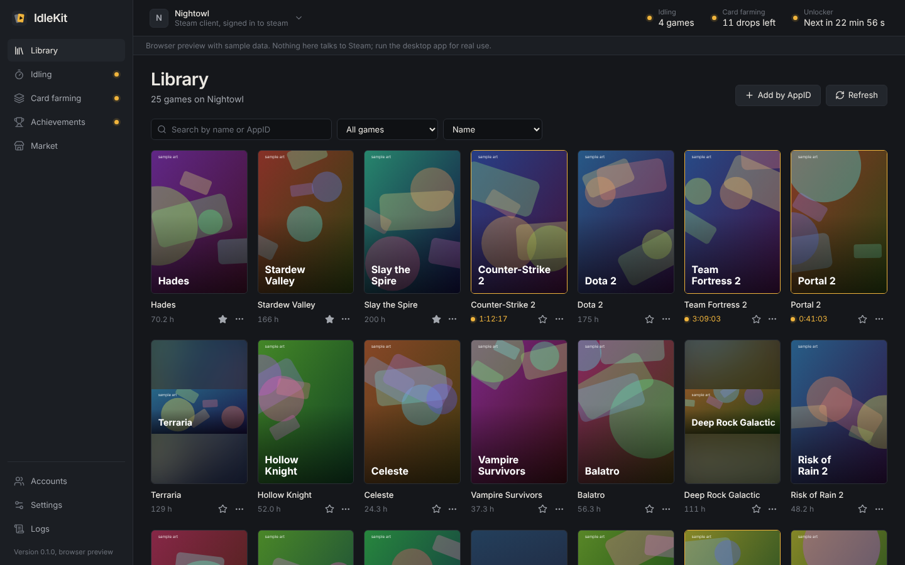
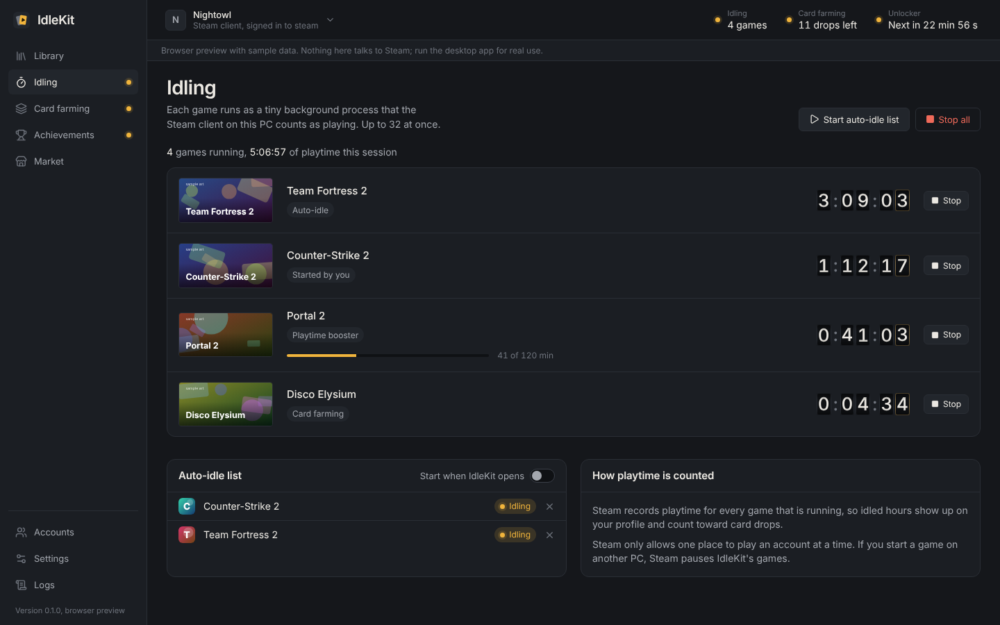
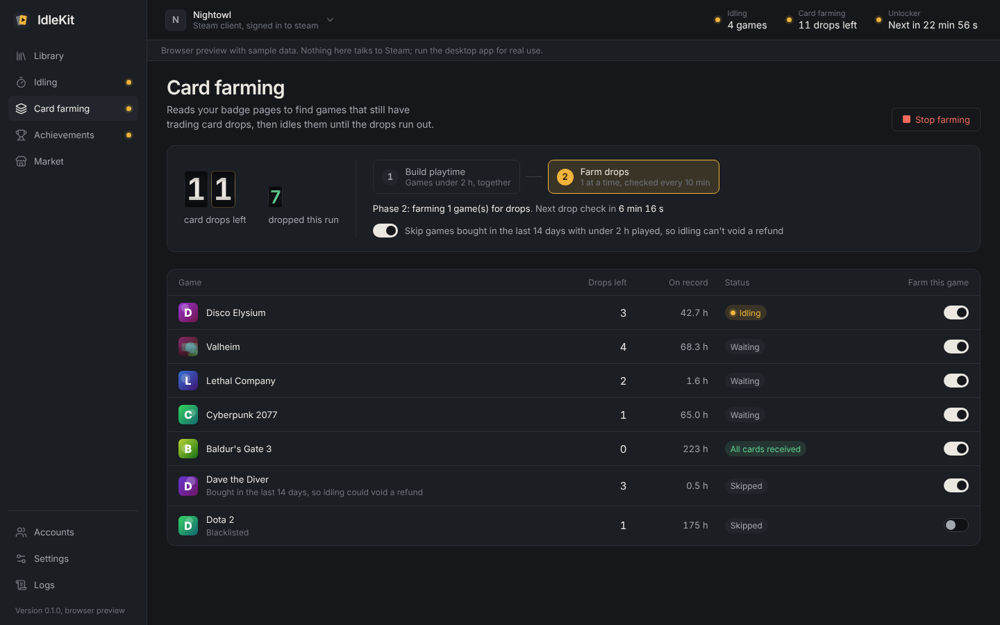
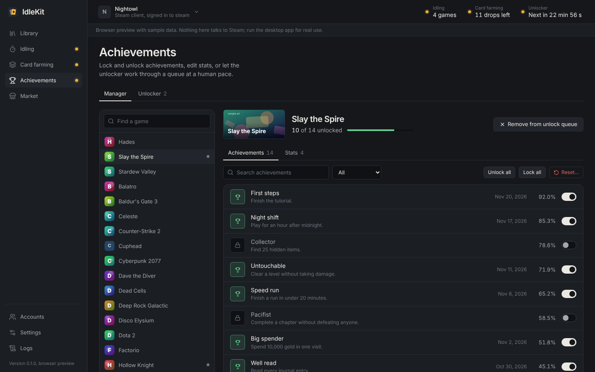

# IdleKit

A desktop app for Steam: farm trading cards, idle games for playtime, manage and auto-unlock achievements, and sell inventory items on the Steam Market. Built with Tauri 2 (Rust) and React.

IdleKit is an independent implementation in the spirit of [Steam Game Idler](https://github.com/zevnda/steam-game-idler), ArchiSteamFarm and Steam Achievement Manager. It contains no code from those projects.



| Idling | Card farming | Achievements |
|---|---|---|
|  |  |  |

Screenshots use the browser preview's sample data. The pictures in them are generated stand-ins marked "sample art", because Steam's image servers couldn't be reached where they were taken. The app shows each game's real Steam cover and icon.

## Installing

Download the latest `IdleKit_…_x64-setup.exe` from the [releases page](https://github.com/ZHUM-REPO/idlekit/releases/latest) and run it. It needs 64-bit Windows 10 or 11.

- The installer isn't code-signed, so Windows may say the publisher is unknown. Choose **More info**, then **Run anyway**.
- It installs for the current user and doesn't ask for administrator rights.
- After that IdleKit keeps itself up to date: it looks for a newer release each time it opens and installs it when you say so.

## Features

- **Idling and playtime booster** – idle up to 32 games at once; boost a game for a set number of hours and stop automatically; an auto-idle list that can start when the app opens.
- **Card farming** – reads your badge pages for games with card drops left, then farms them in two phases: games under the playtime threshold (default 2 h) idle together to build playtime, then the rest idle a few at a time with periodic drop checks and restarts. Skips games bought in the last 14 days with under 2 h played so idling doesn't cost you a refund; purchases are matched by name, so a game that came in a bundle can be missed. Black/whitelists, ordering, and "when farming finishes, start…" chaining.
- **Achievement manager** – lock/unlock achievements, edit stats, see global unlock rates, hidden and protected flags, reset stats.
- **Achievement unlocker** – works through a queue of games, unlocking one achievement at a time with random delays, optional daily time window, custom order and skips, or another player's order and timing copied from their public profile.
- **Market seller** – load your Steam inventory (cards, foils, emoticons, backgrounds, boosters), price from the live order book with min/max limits, list in bulk with Steam's fees shown, select duplicates while keeping one, and bulk-remove listings.
- **Runs in the background** – closing the window can leave IdleKit in the system tray with everything still going, and it can start when you sign in to Windows, straight into the tray. Together with "start the auto-idle list" and "start card farming" in Settings, everything begins by itself: started that early, IdleKit waits up to five minutes for the Steam client to come up before it begins.
- **Updates itself** – new releases from this repository are offered inside the app. Each one is signed, and the app checks the signature against a key built into it before installing anything.
- **Game art everywhere** – each game shows its Steam cover in the library (or the wide banner; choose in Settings) and its icon in every list. Art is looked up through Steam's public store API, which needs no key or sign-in, and cached on disk. Games without a cover fall back to their banner, then to a tile with the game's name.
- **Multiple accounts**, three sign-in methods (this PC's Steam client, QR code with the Steam Mobile app, username/password with Steam Guard), online status per account (online/away/invisible/offline), and custom "now playing" text.
- Graphite, Midnight and Daylight themes with five "running" colors. The interface is set in Inter, the same typeface Steam Game Idler uses by default, bundled with the app so it never loads from the network.

## How it talks to Steam

Each account uses one of two modes, switchable on the Accounts page.

| | Steam client on this PC | Direct connection |
|---|---|---|
| How | One `steam-helper` process per game initializes Steamworks with that game's AppID, so the Steam client counts it as playing (the Idle Master / SAM approach). | IdleKit logs in to Steam's connection managers itself (via [steam-vent](https://crates.io/crates/steam-vent)) and sends `ClientGamesPlayed`, like ArchiSteamFarm. |
| Needs | Steam running and signed in to that account. | A QR or password sign-in (stores a refresh token). |
| Accounts | One at a time | Many at once, Steam can be closed |
| Achievements | Yes | No – needs the Steam client |

Card farming and the market also need a **web session** (steamcommunity.com cookies). A QR/password sign-in provides one automatically; for client-only accounts you can paste a `steamLoginSecure` cookie instead.

Refresh tokens and cookies are stored in the Windows Credential Manager / macOS Keychain. On Linux they go in `secrets.json` in the app data folder with owner-only permissions.

## Building

Release installers are built by GitHub Actions (see [Releasing](#releasing-a-new-version)), so building locally is only needed for development.

### Prerequisites

- **Rust** 1.90 or newer (`rustup`; on Windows the MSVC toolchain)
- **Node.js** 20 or newer
- **Windows:** WebView2 (preinstalled on Windows 10/11) and the "Desktop development with C++" workload from Visual Studio Build Tools
- **Linux:** `libwebkit2gtk-4.1-dev build-essential libxdo-dev libssl-dev libayatana-appindicator3-dev librsvg2-dev`

### Run in development

```bash
npm install
npm run app:dev      # builds steam-helper, then runs `tauri dev`
```

`npm run dev` alone serves the UI in a normal browser with sample data (no Steam access), which is handy for UI work.

### Build an installer

```bash
npm run app:build    # release steam-helper + `tauri build`
```

Installers land in `src-tauri/target/release/bundle/` (NSIS and MSI on Windows; deb, rpm and AppImage on Linux). A copy built this way has nowhere to look for updates and says so in Settings; only the release workflow's builds update themselves.

`scripts/prepare-helper.mjs` builds the helper, copies it to `src-tauri/binaries/steam-helper-<target-triple>` (Tauri's sidecar naming), and copies Valve's Steam API redistributable (`steam_api64.dll` / `libsteam_api.so`, shipped inside the `steamworks-sys` crate) into `src-tauri/resources/`, which the installer places next to the app.

### Tests

```bash
npm run test:rust      # parsers, fee math, farming/unlocker scheduling, tray and update logic
npm run test:scripts   # the release scripts
npm run typecheck
```

The installer has a check of its own, `scripts/install-check.ps1`. On Windows it installs a setup file without asking anything, looks at what was installed, starts the app and waits for its window, opens it a second time, and uninstalls it again. It installs and removes IdleKit for the current user, so it is meant for a machine where that doesn't matter. **Actions → Check the installer → Run workflow** runs it on GitHub against a published release.

## Releasing a new version

`.github/workflows/release.yml` builds the Windows installer on every change to `main`, and publishes it as a release when the version hasn't been released yet. To release:

1. Raise `version` under `[package]` in `src-tauri/Cargo.toml`. That is the only place the app's version is set.
2. Add a `## <version>` section to `CHANGELOG.md`. It becomes the text of the release page.
3. Commit to `main`. Both edits can be made on github.com with the pencil button.

About fifteen minutes later the release has the installer, its signature and `latest.json`, which installed copies read to learn that a newer version exists. Before publishing, the workflow runs the install check on the new setup file; one that fails is not published.

**The signing key.** The workflow signs the installer with the repository secret `TAURI_SIGNING_PRIVATE_KEY`; the matching public key is `plugins.updater.pubkey` in `src-tauri/tauri.conf.json`. Without a working key the installer is still built and released, but that build can't update itself. An installer signed with any other key is not released at all, because installed copies would refuse it. If the key is ever lost, make a new pair with `npx tauri signer generate`, put the public half in `tauri.conf.json` and the private half in the secret. Copies installed before the change won't accept updates signed with the new key and have to be reinstalled once by hand.

## Project layout

```
src/                     React UI (Vite, Tailwind 4, zustand)
  styles.css             themes, Inter (via @fontsource-variable/inter, OFL), odometer
  lib/api.ts             typed wrappers for every Tauri command
  lib/mock.ts            sample-data backend for browser preview
  lib/art.ts             which image URLs to try for a game, and the batched art lookup
  components/Desktop.tsx the "update available" bar and the keep-running-or-quit question
  pages/                 Library, Idling, Card farming, Achievements, Market, Accounts, Settings, Logs
src-tauri/src/
  commands.rs            all Tauri commands
  state.rs               shared state, web sessions, games list sources
  desktop.rs             tray icon, what the close button does, starting at sign-in
  updates.rs             looking for, downloading and installing a newer release
  features/              idler (shared by everything), farming, unlocker
  steam/                 cm (direct connection), auth (QR + password), community (badges,
                         licenses, profiles), market, helper (process manager), schema +
                         kv_binary (achievement schema files), local (Steam install detection),
                         art (icon, cover and banner lookup with a disk cache)
src-tauri/helper/        steam-helper: per-game Steamworks process (JSON lines over stdio)
src-tauri/windows/       hooks.nsh: stops running helpers before the installer copies files
scripts/                 prepare-helper.mjs (helper build); release-info, build-release and
                         release-files (used by the release workflow; logic in lib/release.mjs);
                         install-check.ps1 (installs, starts and uninstalls a setup file);
                         fake-steam.mjs, a stand-in for Steam's store API and image hosts for
                         working on game art offline (usage in the file)
.github/workflows/       release.yml: builds, checks and publishes the Windows installer;
                         install-check.yml: runs the install check on a published release
```

## Status

What has been tested, and how:

- **Logic:** 41 backend unit tests (badge/licence/profile/inventory/listing parsers, binary KeyValues and achievement schemas, fee math for dollar and other wallets, pricing, farming phases, unlocker ordering, delays and time windows, the game-art lookup with its batching and cache, what the close button does, when to start in the tray, when a playtime boost ends) and 9 tests of the release scripts. The UI type-checks, and every UI call matches a registered command.
- **The app on Linux**, against a mock Steam install: adding a local account, loading its games, launching `steam-helper` for a game.
- **Start on launch, on Linux** against a stand-in Steam client that only appears twelve seconds after IdleKit: auto-idle waits, then starts within seconds of Steam being there; with no Steam installed it says so at once.
- **Tray and startup, on Linux:** the close question, hiding to the tray and coming back from a second launch, the tray menu (driven over D-Bus), the sign-in startup entry being written and removed, starting in the tray, and opening the window after an update.
- **Updater, on Linux against a local update server:** finding a newer version at startup and from the tray menu, accepting a file signed with the release key, and refusing one that was altered after signing.
- **Game art**, against `scripts/fake-steam.mjs`: the lookup, the disk cache, covers in hashed folders, and each fallback.
- **The Windows installer, on GitHub's Windows machine:** the app and the helper compile, and the installer is built and signed. Each setup file is checked before it is published (0.2.0 and 0.2.1 so far): it installs without asking anything; puts the app, the helper and Steam's library in place; creates Start menu and desktop shortcuts; the installed app opens its window with WebView2 running; opening it a second time hands over to the copy already running; and uninstalling removes all of it.

What has not been tested: anything against live Steam servers or a running Steam client, and these Windows-only parts: Steam's registry keys, the Credential Manager, the tray icon and its menu, starting at sign-in, the check that Steam's process is still there, the market's fee numbers against a real wallet in another currency, and an installed copy updating itself to a newer release (0.2.0 to 0.2.1 is the first chance to see it). The first things to try on Windows, in this order:

1. **Local mode:** add your account from "This PC's Steam". The library should fill with covers within a second or two, and lists should show each game's icon; if they don't, look on the Logs page for a warning from `art`. Then idle a game and check Steam shows you in-game.
2. **Achievements:** open a game in the Manager; the list should load in a few seconds.
3. **QR sign-in** (Accounts → Add account → QR code), then **Connect** a direct account and idle a game.
4. **Card farming → Check badges.**
5. **Market → Load inventory → Get prices.** Only list items once prices look right.

The Logs page (Copy button) has what's needed to debug anything that fails.

## Use responsibly

Idling games and farming cards is widely tolerated, but automated achievement unlocking and bulk market activity are against the spirit of Steam's rules and some games' terms; online games with VAC or their own anti-cheat may treat stat edits as cheating. Steam also rate-limits the market and community pages hard. Use at your own risk, and keep the default delays.
